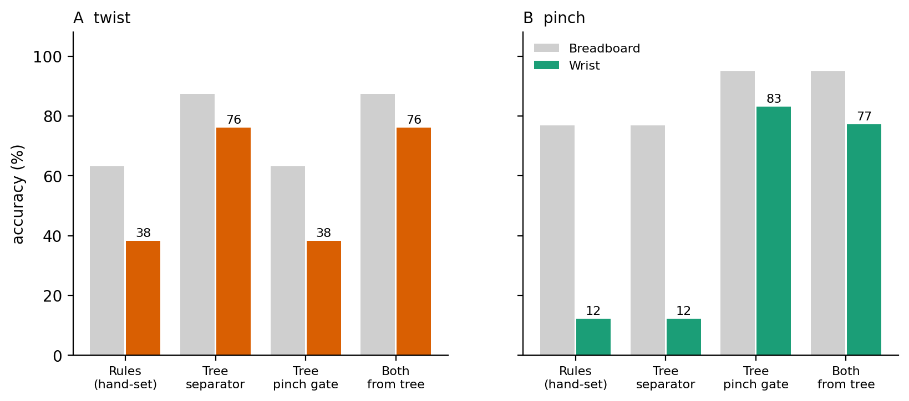

# LYRA: why a wrist gesture recognizer survived a hardware change

LYRA is a wrist-worn gesture controller I built: an ESP32 and a 6-axis IMU
that recognize flick, twist and pinch on the device itself and send them to
a phone or laptop as Bluetooth media keys (no app, no cloud). This repo has
the data, analysis code and firmware behind the research write-up.

**The finding in 30 seconds.** When the electronics moved from a breadboard
held loosely on the hand (3 people, 401 gesture windows) to a snug wrist
enclosure (10 people, 1000 windows), the hand-tuned rules collapsed (pinch
77% → 12%, twist 63% → 38%) while a small learned decision tree, never
retrained, held at about 76%. Counterfactual tests show why:

- **Two thresholds cause the whole effect.** Swapping one decision boundary
  between the two classifiers restores or breaks exactly one gesture, in both
  directions, and for all ten participants individually.
- **Learning isn't the cause.** The same hand-written rules with their two
  numbers re-fitted from data transfer too.
- **Critical gain.** The snug mount acts like a gain on the signal
  (accelerometer variance ×0.68). A threshold breaks when that gain crosses
  its *critical gain*: threshold ÷ median of the gesture it protects. The
  hand-set thresholds sat at 0.92 and 0.85, inside the shift; the tree's sat
  far outside it. This predicts which boundaries fail and which way each
  repeat participant's accuracy moved.



*Grey: breadboard. Colour: wrist. Twist accuracy depends only on which
twist/pinch separator is used; pinch accuracy only on which pinch boundary
is used.*

**Status:** manuscript in preparation. `paper/` holds an earlier version of
the write-up; its explanation of the effect ("the tree captures shape, not
magnitude") was tested by `research/mechanism.py` and turned out to be wrong.
The critical-gain account above replaces it.

## What's here

- `data/` -- the two gesture datasets. `lyra_multisubject.csv` is the
  original three-subject breadboard collection (subjects anonymized to
  A-D); `real_10subj.csv` is the ten-subject wrist-mounted collection.
- `research/` -- the analysis scripts. `lyra_ml.py` is a leave-one-subject-out
  harness (stdlib only, no numpy/pandas/sklearn) that reproduces Tables 1-2
  and emits the stage-2 tree as C++. `cross_hardware.py` reproduces Tables
  3-6, the cross-hardware and within-subject comparisons. `make_figures.py`
  regenerates Figures 1-3. `firmware_port.py` is a Python port of the
  deployed classifier, used to evaluate it against raw sensor features
  without needing the actual microcontroller. `mechanism.py` runs the
  counterfactual experiments that explain *why* the rules broke on the wrist
  mounting and the hybrid did not (component swaps, re-fitted thresholds,
  critical gain, a synthetic gain sweep, bootstrap trees, a per-participant
  check, leave-one-participant-out gains and a label-free gain estimate),
  and writes the three `figures/mechanism_*.png`.
- `firmware/` -- the device firmware. `lyra_daily_hid/` is the deployed
  classifier; the shared DSP, classifier, IMU, LED and power logic lives in
  `lib/*.h`, so each sketch is just its output stage. The other sketches
  reuse the same core: `lyra_calibration_stream/` (BLE data stream for
  calibration), `lyra_collect_serial/` (serial CSV logging for data
  collection), `lyra_ev3_bridge/` (gesture events over BLE UART for the
  robot arm), `lyra_keyboard_hid/`, and the later ring, glasses and lantern
  variants. `tools/` has helper scripts for over-the-air updates and audio.
- `ev3/` -- the LEGO EV3 robot-arm code (ev3dev Python): the arm driver,
  inverse kinematics with its test, jog and range-test utilities, routines,
  and the shared motor limits in `lyra_config.py`.
- `bridge/` -- `lyra_to_ev3.py`, which connects to the wristband over BLE and
  forwards each gesture to the EV3 arm (reconnects, heartbeat, safe park).
- `case/` -- the 3D-printed two-storey wrist enclosure: OpenSCAD sources,
  STL files for each version, renders, and an STL verification script.
- `figures/` -- the regenerated figures plus a photo of the two hardware
  mountings referenced in the paper.
- `paper/` -- an earlier version of the manuscript (see Status above).

## Reproducing the tables

```bash
python3 research/lyra_ml.py data/lyra_multisubject.csv       # Tables 1-2
python3 research/cross_hardware.py                            # Tables 3-6
python3 research/make_figures.py                              # Figures 1-3
python3 research/mechanism.py --markdown --figures            # mechanism analysis
```

No dependencies beyond Python 3 and matplotlib (only needed for the last
one). The stage-2 tree `lyra_ml.py` emits from the committed data matches
the tree actually flashed to the device -- see the paper's Reproducibility
note in section 5.2 for the one caveat (depth/min-leaf-size sensitivity in
one boundary split).

## Data

Both CSVs have the same 12 columns: `subject, label, peakGyro, ratio,
durationCount, gySigned, gzSigned, peakAccel, accelMean, accelStd,
spikeCount, classified`. `label` is the ground-truth gesture, `classified`
is whatever the device's on-board rule cascade called it at collection
time -- that's the "no calibration" accuracy in Table 1.

Subject identifiers are single letters (A-D in the first collection, A-J in
the second) rather than names. Three participants in the second collection
are the same people as A/B/C in the first, which is what section 5.4's
within-subject comparison uses.

## Firmware

`firmware/lyra_daily_hid/lyra_daily_hid.ino` is Arduino/ESP32 code for an ESP32-C3 with an MPU-6050
or compatible clone on I2C (SDA=GPIO6, SCL=GPIO7). It reads the IMU,
extracts the same nine features the analysis scripts use, runs the same
two-stage classifier, and reports gestures over BLE as HID media keys, so
it works with any host without a companion app. A short LED glow confirms
each recognised gesture.

## Credits

Device, firmware, data collection and the original analysis: Siddharth
Bansal. The counterfactual analysis in `research/mechanism.py` was written
with the help of an AI assistant; every number it produces comes from the
data in `data/`.

## License

MIT. See `LICENSE`.
