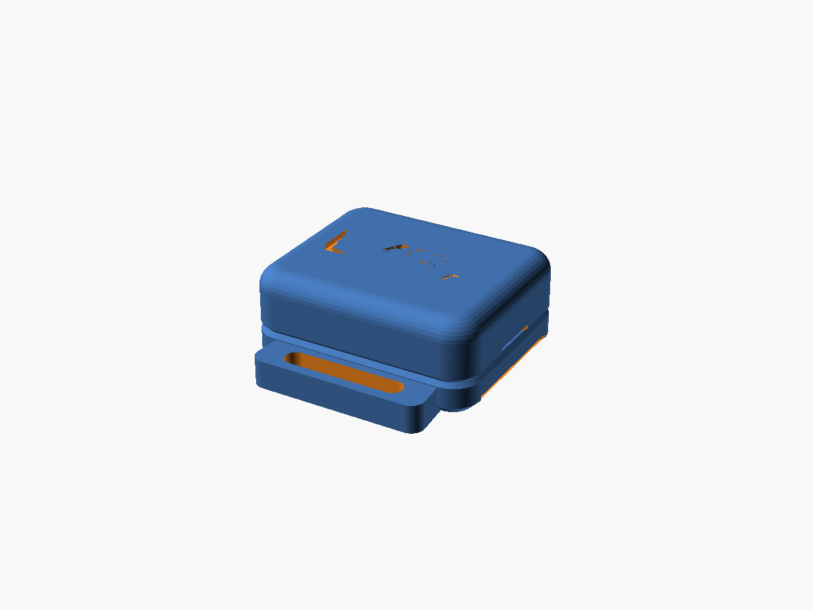
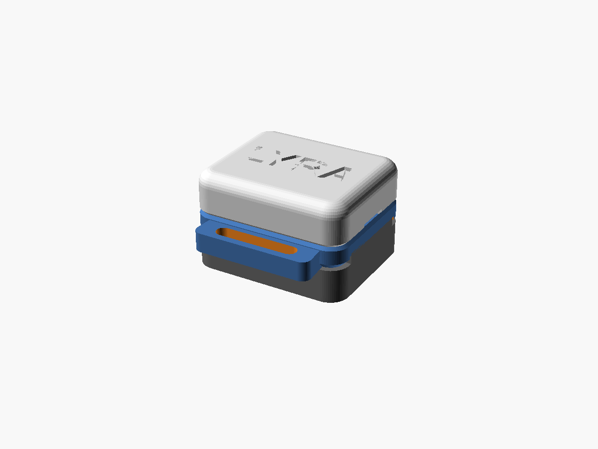
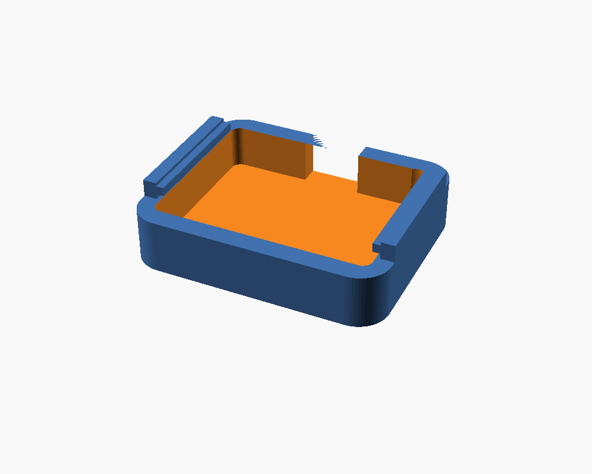

# LYRA — 2-story wrist enclosure

Stacked case for the wearable: **MPU-6050 (GY-521)** on the lower floor,
**ESP32-C3 SuperMini** on the upper floor, splitting at the divider so you can
solder the inter-board wires through the pass-throughs and *then* close it.

<p align="center">
  
  
  
</p>

## Two versions
- **Functional (`lyra_case.scad`)** — the practical box: open-top ESP pocket, USB-C
  notch, side strap slots. Easiest to assemble/debug.
- **Pro (`lyra_case_pro.scad`)** — product finish: rounded corners, pillowed top,
  chamfered base, recessed seam reveal, sealed body, pill USB-C port, debossed
  `LYRA` wordmark, integrated watch-style band lugs.

Both split at the divider and share the same internals + the **clip-on battery sled**.

## Files
```
case/
├── lyra_case.scad        functional source  (edit dims here)
├── lyra_case_pro.scad    pro/product source
├── stl/                  ready-to-slice exports
│   ├── lyra_plate.stl / lyra_pro_plate.stl      both halves laid flat — PRINT THIS
│   ├── lyra_base.stl  / lyra_pro_base.stl
│   ├── lyra_top.stl   / lyra_pro_top.stl
│   └── lyra_battery.stl (shared sled)  / lyra_pro_battery.stl
└── renders/             preview images
```

## Battery sled (optional, future use)
A separate tray that **snaps onto the two short ends** of the base (the band lugs are
on the long sides, so no clash) — charging still happens over USB-C; the sled is purely
additive. The base has tiny detents (`batt_mount`) for the sled barbs and a small wire
pass-through (`batt_wire`) so the cell's +/- wires reach up to the ESP32 (solder to a
5V/BAT pad + GND; the 2 spare divider holes carry them up). Set `batt_L/W/H` to your
LiPo, print `*_battery.stl`, drop the cell in, route the wires, and clip it on.
Note: a sealed LiPo with no charge IC means charge **only** via USB-C while plugged in,
or add a TP4056 — don't charge an unmanaged cell.

## Current dimensions (defaults)
- **Functional:** 25.7 × 21.2 × **8.2 mm**
- **Pro:** 26.1 × 21.6 × **10.6 mm** (taller because it's fully sealed w/ USB-C headroom)
- Board clearance 0.4 mm/side · 2 × 3 Ø2.4 mm wire pass-throughs
- Height floor: the parts stack (MPU ~3 + divider + ESP ~1.4 + USB-C headroom ~3.4)
  is ~8 mm and unavoidable; thinner means trimming shell/clearances or a thinner
  (direct-soldered, header-removed) MPU — set `mpu_H` to your measured value.

> ⚠️ You asked for 24 × 19 mm. An ESP32-C3 SuperMini is ~18 mm wide on its own,
> so 19 mm outer can't hold it once real (printable) walls are added — the case
> width has to be ≈21 mm. Everything is parametric; see "Tuning" to push it
> smaller if your board measures narrower.

## Print
- Material: **PLA or PETG**. PETG if it'll sit against skin in the sun.
- 0.2 mm layers, 3 perimeters, 20–30% infill. **No supports needed.** Add a
  **brim** (~3 mm) — the parts are small and the top prints on a narrow rim.
- Orientation: use the parts **as laid out in `lyra_plate.stl`** — base and
  battery open-side up, the **top flipped** (wall rim on the bed, lip pointing
  up). ⚠️ Do **not** print the top lip-down: its first 2 mm is only the thin
  0.9 mm alignment lip, and the whole shell cross-section then appears in
  mid-air above it — it curls, the nozzle catches the curl, and the part
  blobs out (this failed twice before the STLs were re-oriented). The
  divider bridges the ESP pocket when flipped; PLA handles that span fine.
- **Pro top (`lyra_pro_top.stl`) can't be flipped** (pillowed dome). Print it
  lip-down but with a brim **and supports** (build-plate-only is enough — the
  overhang ring is just 2 mm up); support scars land on the hidden seam face.

## Wiring (4 nets, I2C)
| MPU-6050 pin | ESP32-C3 SuperMini pad | use the cluster on… |
|---|---|---|
| VCC | **3V3** | the *power* long edge |
| GND | **GND** | the *power* long edge |
| SCL | **GPIO6** | the *I2C* long edge |
| SDA | **GPIO7** | the *I2C* long edge |

Firmware: `Wire.begin(7 /*SDA*/, 6 /*SCL*/);` for the C3 SuperMini (the
breadboard sketch's GPIO21/22 was for the full ESP32 DevKit).

The divider has a 3-hole cluster along **each** long edge. The GY-521's pins are
all on one edge, but the ESP's 3V3/GND and GPIO6/7 are on *opposite* edges — so
power wires go up the cluster nearest 3V3/GND, and SDA/SCL up the cluster nearest
GPIO6/7. Both clusters are identical, so it works whichever way you seat the ESP;
just use the holes closest to each target pad.

## Assembly (solder-while-building)
1. Drop the **MPU-6050** into the floor recess of `base`, pins up.
2. Sit the **ESP32-C3** in the `top` pocket, USB-C aligned to the notch.
3. Hold the halves apart and route the 4 wires up through the divider holes per
   the table above. Solder the MPU end and the ESP end (castellated pads).
4. Fold the slack into the lower cavity and press `top` onto `base` — the lip
   self-centers and the snap bumps click into the dimples.
5. Thread an elastic/velcro strap through the two side slots.

**To re-open:** insert a fingernail or flat spudger into the **pry notch** at the
short end opposite the USB-C (it sits right over a snap) and twist to release.

Tip: a dab of hot glue or a 0.5 mm foam pad over the MPU keeps it rattle-free for
cleaner gesture data.

## Tuning (edit `lyra_case.scad`, then re-export)
- `esp_L/W/H`, `mpu_L/W/H` — **caliper your actual boards and set these**.
- `wall`, `fit` — drop to `0.8` / `0.3` for a slimmer shell (~24.7 × 20.2 mm).
- `wire_per`, `wire_d`, `wy` (in `wirerow`) — holes per edge / size / inset.
- `make_lid = true` — adds a clip-on cover over the ESP32 (`part="lid"`).
- `strap_w`, `strap_t` — match your band.

Re-render from the CLI (parts: `base` | `top` | `battery` | `plate` | `all`):
```bash
OS=/opt/homebrew/bin/openscad
$OS -o stl/lyra_plate.stl     -D 'part="plate"' lyra_case.scad
$OS -o stl/lyra_pro_plate.stl -D 'part="plate"' lyra_case_pro.scad
```

## Not yet included — battery
A LiPo won't fit inside this footprint, and the ESP32-C3 SuperMini has **no
onboard charge circuit** — charging a cell needs a TP4056 (or a SuperMini variant
with charging). Options if you want untethered power:
- **Tethered (current):** power/charge over the USB-C notch. No size change.
- **External LiPo** (e.g. 301220 ~60 mAh) in a third stacked floor + TP4056. Adds ~5 mm height.
Say which way and I'll extend the model.
